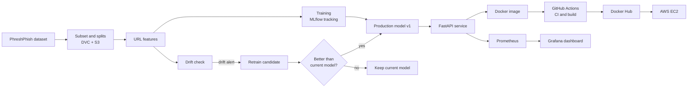

# AdaptivePhish

Drift-aware MLOps lifecycle for phishing URL detection: versioned data (DVC), tracked
experiments (MLflow), a FastAPI service, Docker, GitHub Actions CI/CD, AWS EC2 deployment,
Prometheus/Grafana monitoring, and drift-triggered retraining with gated model promotion.

Status: work in progress. See [PROGRESS.md](PROGRESS.md) for the evidence-backed checklist.
Full specification: [AdaptivePhish_Master_Project_Prompt.md](AdaptivePhish_Master_Project_Prompt.md).

## Setup (Windows, cmd)

```bat
cd /d E:\Projects\Mlops-
python -m venv .venv
.venv\Scripts\activate.bat
python -m pip install -r requirements-dev.txt
python -m pip install -e .
python -m pytest
python -m ruff check .
```

Python 3.11 is required.

## Team

| Member | GitHub | Role |
|---|---|---|
| Ajit Jain | [@ajitjain04](https://github.com/ajitjain04) | Pipeline, DVC, CI/CD, AWS deployment |
| <His Full Name> | [@MrLoSt1805](https://github.com/MrLoSt1805) | Documentation, architecture diagram and evidence |
| <Third Member Name> | [@DheerAjmera](https://github.com/DheerAjmera) | Tests, viva preparation and demo support |


## Project overview

AdaptivePhish is an MLOps pipeline for detecting phishing URLs. A model reads only the URL string, so it needs no web page download, and it labels the URL as phishing or legitimate. The model is trained on a dated phishing dataset, which lets us test it on newer URLs instead of a random split.

Phishing URLs change over time, so a model that was accurate on old data can get worse on new data. This change in the data is called drift. The system compares the features of new URLs with a reference period and raises an alert when they differ enough.

A drift alert does not deploy a new model automatically. It only triggers retraining, and the new model must beat the current one on a validation window and pass fixed checks before it is promoted. Otherwise the current model stays in production.

The whole lifecycle is versioned and automated: data with DVC, experiments with MLflow, builds with GitHub Actions, serving with Docker on AWS, and monitoring with Prometheus and Grafana.

## Architecture

