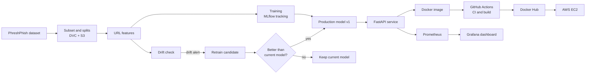
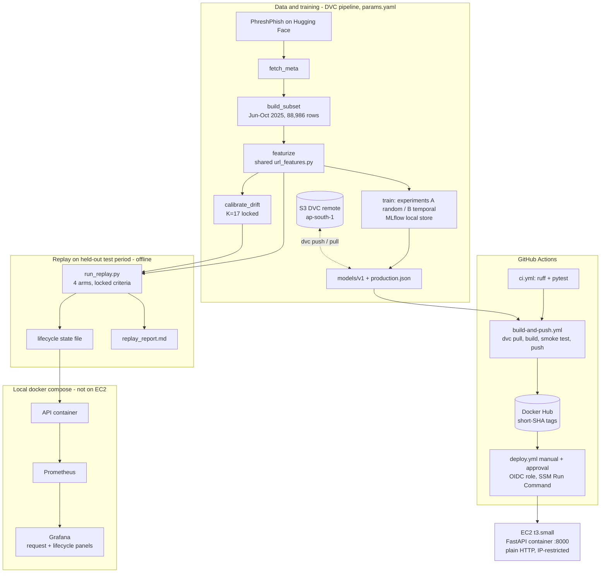

# AdaptivePhish

Drift-aware MLOps lifecycle for phishing URL detection: versioned data (DVC), tracked
experiments (MLflow), a FastAPI service, Docker, GitHub Actions CI/CD, AWS EC2 deployment,
Prometheus/Grafana monitoring, and drift-triggered retraining with gated model promotion.

Status: all milestones (M1-M12) are done. Every claim below points to evidence in
[PROGRESS.md](PROGRESS.md) (checklist with commands and key output) or to a file under `reports/`.
Full specification: [AdaptivePhish_Master_Project_Prompt.md](AdaptivePhish_Master_Project_Prompt.md).

**Contents:** [Setup](#setup-windows-cmd) | [Team](#team) | [Overview](#project-overview) |
[Architecture](#architecture) | [Results](#results-and-hypotheses) | [Limitations](#limitations) |
[Reproduce](#reproduce-from-a-clean-checkout) | [Run locally](#run-it-locally) |
[CI/CD and EC2](#cicd-and-aws-deployment) | [Demo script](#demo-script) | [Evidence](#evidence) |
[Evaluation mapping](#evaluation-mapping) | [Costs and cleanup](#costs-and-aws-cleanup-checklist)

## Setup (Windows, cmd)

```bat
cd /d E:\Projects\Mlops-
python -m venv .venv
.venv\Scripts\activate.bat
python -m pip install -r requirements-dev.txt
python -m pip install -e .
python -m pytest
python -m ruff check .
```

Python 3.11 is required.

## Team

| Member | GitHub | Role |
|---|---|---|
| Ajit Jain | [@ajitjain04](https://github.com/ajitjain04) | Pipeline, DVC, CI/CD, AWS deployment |
| <His Full Name> | [@MrLoSt1805](https://github.com/MrLoSt1805) | Documentation, architecture diagram and evidence |
| <Third Member Name> | [@DheerAjmera](https://github.com/DheerAjmera) | Tests, viva preparation and demo support |


## Project overview

AdaptivePhish is an MLOps pipeline for detecting phishing URLs. A model reads only the URL string, so it needs no web page download, and it labels the URL as phishing or legitimate. The model is trained on a dated phishing dataset, which lets us test it on newer URLs instead of a random split.

Phishing URLs change over time, so a model that was accurate on old data can get worse on new data. This change in the data is called drift. The system compares the features of new URLs with a reference period and raises an alert when they differ enough.

A drift alert does not deploy a new model automatically. It only triggers retraining, and the new model must beat the current one on a validation window and pass fixed checks before it is promoted. Otherwise the current model stays in production.

The whole lifecycle is versioned and automated: data with DVC, experiments with MLflow, builds with GitHub Actions, serving with Docker on AWS, and monitoring with Prometheus and Grafana.

## Architecture



### As implemented (what is real, what is replay-only)



Solid boxes inside `replay` run offline on recorded data. The deployed EC2 service serves model V1 and is **not**
retrained or hot-swapped by the replay; the retraining/promotion logic is exercised and evidenced in the
replay only.

## Results and hypotheses

Dataset: [PhreshPhish](https://huggingface.co/datasets/phreshphish/phreshphish) (revision `eca603e0`,
CC-BY-4.0, anti-phishing research use only). Subset: 2025-06..2025-10, up to 10,000 URLs per month and class
(88,986 rows). Chronological split: train Jun-Jul, validation Aug, test Sep-Oct. Details:
[dataset_report.md](reports/results/dataset_report.md), [experiments_report.md](reports/results/experiments_report.md).

**Model V1:** random forest on 26 URL-only features, chosen by temporal validation F1 only; threshold 0.183
chosen on validation. Test F1 0.838 (95% bootstrap CI 0.834-0.841), precision 0.790, recall 0.891, FPR 0.207.

| Algorithm | Test F1, random split | Test F1, temporal split |
|---|---|---|
| Logistic regression | 0.817 | 0.801 |
| Random forest | 0.924 | 0.838 |
| XGBoost | 0.920 | 0.838 |
| LightGBM | 0.926 | 0.836 |

Replay on the test period (37,501 URLs, 19 batches of 2,000, arms and promotion criteria locked before the
run; [replay_report.md](reports/results/replay_report.md), [timeline figure](reports/figures/replay_timeline.png)):

| Arm | Drift alerts | Retrain attempts | Promoted | Pooled test F1 |
|---|---|---|---|---|
| static V1 | 0 | 0 | 0 | 0.8377 |
| adaptive, K=17 (primary) | 0 | 0 | 0 | 0.8377 |
| adaptive, K=10 (sensitivity) | 4 | 3 | 0 | 0.8377 |
| fixed monthly retrain | n/a | 1 | 1 | 0.8400 |

| Hypothesis | Verdict | Evidence and caveats |
|---|---|---|
| **H1** temporal degradation | **Supported, with caveats** | Same algorithm, tree models: test F1 about 0.92 with a random split vs about 0.84 with a chronological split. One seed, one split. Part of the drop may come from how each class was collected (class and date are confounded in this dataset), not from drift alone. |
| **H2** performance change is associated with feature drift | **Weak** | Over the 19 replay batches the number of drifted features correlates 0.17 with V1's F1, while F1 correlates 0.91 with each batch's phishing share. The two worst batches had only 7-8 drifted features. Class mix also moves feature distributions, so the two effects cannot be separated here. |
| **H3** drift-triggered retraining recovers performance and avoids needless retraining | **Not supported** | K=17 never alerted (max 15 of 20 features), so it avoided retraining but recovered nothing. K=10 made 3 attempts and all were rejected. The only promotion (fixed monthly) gained 0.002 pooled F1. Differences this small are within what another seed or batch boundary could change. |

## Limitations

- **One seed, one replay, one dataset.** No repeated seeds or splits; 19 replay batches and at most 3 retrain
  attempts per arm. Small differences are not conclusive.
- **Dataset confounding.** Class and collection date are confounded (no benign URLs Nov 2024-May 2025), so the
  window is only Jun-Oct 2025. Benign URLs have no query/fragment in this data (those three features were
  excluded). `path_depth` and `path_len` are the strongest features and may reflect how benign pages were
  crawled. Per-batch F1 mostly follows the phishing share of the batch.
- **About 21% false-positive rate** at the F1-optimal threshold (test FPR 0.207). Too high for an unattended
  detector; a different operating point is a product decision. Scores are uncalibrated probabilities.
- **K=17 is conservative.** The reference window itself is not stationary, so the calibrated rule is quiet
  (0/10 validation alerts, 0/19 test alerts) and did not signal the performance dips.
- **Strict promotion rule.** A candidate with a significant F1 gain and a far lower FPR was rejected because
  recall fell more than 0.02 (see the replay report). The criteria were locked beforehand and were not tuned.
- **Replay, not a live loop.** Labels are assumed to arrive exactly one batch late (optimistic). Retraining is
  not wired to the deployed service.
- **EC2 has no Prometheus/Grafana.** Monitoring runs only in the local docker compose stack. Lifecycle panels
  show replay output there, not live telemetry from EC2.
- **Plain HTTP on EC2.** No TLS and no authentication; the only protection is a security-group rule limited to
  the operator's IP. Do not open it to the internet.
- **Smaller points:** the MLflow store is local (not in the repo or on S3); `/health` does not report the image
  tag; a clean `dvc repro` from the raw Hugging Face data has not been timed or compared model-byte for byte;
  the README Team table still has two placeholder names (owned by the teammates).

## Reproduce from a clean checkout

Verified on 2026-10-28 on Windows 11 / Python 3.11 in a fresh clone (see [PROGRESS.md](PROGRESS.md) for the log
summary). Commands for cmd; on Linux/macOS use `source .venv/bin/activate`.

```bat
git clone https://github.com/ajitjain04/Mlops-.git
cd Mlops-
python -m venv .venv
.venv\Scripts\activate.bat
python -m pip install -r requirements-dev.txt
python -m pip install -e .
python -m pytest
python -m ruff check .
```

The model and the processed data are not in Git; DVC pulls them from S3 (`.dvc/config` has the bucket URL and
region, **not** the credentials).

**Option A, project owner (full access).** Create an AWS profile locally and point the remote at it. The profile
name is kept in the gitignored `.dvc/config.local`.

```bat
aws configure --profile adaptivephish
dvc remote modify --local storage profile adaptivephish
dvc pull
dvc status
```

`dvc status` should report "Data and pipelines are up to date". Never put keys in the repository, `.env.example`
or chat.

**Option B, read-only access for other people.** The bucket owner creates an IAM user with only read access to
the DVC prefix, hands the access key out of band, and the reader runs `aws configure --profile adaptivephish-ro`,
then `dvc remote modify --local storage profile adaptivephish-ro` and `dvc pull`:

```json
{
  "Version": "2012-10-17",
  "Statement": [
    {"Effect": "Allow", "Action": "s3:ListBucket",
     "Resource": "arn:aws:s3:::adaptivephish-dvc-ajit-2026",
     "Condition": {"StringLike": {"s3:prefix": ["dvc/*"]}}},
    {"Effect": "Allow", "Action": "s3:GetObject",
     "Resource": "arn:aws:s3:::adaptivephish-dvc-ajit-2026/dvc/*"}
  ]
}
```

CI uses the same pattern: a read-only user (`adaptivephish-ci`) whose keys are GitHub secrets.

**Option C, no S3 access.** Rebuild from the public dataset: `dvc repro` downloads the dataset metadata from
Hugging Face and re-runs every stage (subset, features, experiments, drift calibration). The subset hash
`aa62bfce...` is reproducible (checked repeatedly); retraining time and bit-for-bit model identity on another
machine have not been checked.

**Then verify the replay lock and re-run the replay** (same lock, same results apart from timings):

```bat
python -c "from adaptivephish.replay_lock import verify; print(verify())"
python scripts/run_replay.py --mode test
```

The replay refuses to run if the locked values in `params.yaml` (`replay`, `drift.locked`) differ from
`reports/results/replay_lock.json`, if that file has uncommitted edits, or if results from a different lock exist.

## Run it locally

```bat
:: API on the host (needs models/v1 from dvc pull)
uvicorn adaptivephish.api.app:app_factory --factory --port 8000
curl http://127.0.0.1:8000/health
curl -X POST http://127.0.0.1:8000/predict -H "content-type: application/json" -d "{\"url\":\"http://paypal-secure-login.example-verify.com/signin?id=1\"}"

:: API + Prometheus + Grafana (127.0.0.1 only)
copy .env.example .env
:: edit .env: set GRAFANA_ADMIN_PASSWORD, optionally IMAGE_TAG
docker compose up -d --build
```

Grafana http://127.0.0.1:3000, Prometheus http://127.0.0.1:9090, API http://127.0.0.1:8000
(`/health`, `/predict`, `/metrics`, `/docs`). `score` is an uncalibrated phishing probability.

**Web UI:** open `/` on the API (for example http://127.0.0.1:8000/). It is one self-contained page
(`src/adaptivephish/api/static/index.html`; no build step, no CDN, works offline) served by the same FastAPI app:
a URL checker with a verdict, score bar and threshold marker, a status strip from `/health`, a session-only
history (kept in memory, never stored or logged), and a "Lifecycle results" tab with the four-arm replay table.
The table is a trimmed copy of `replay_results.json`; refresh it with `python scripts/embed_replay_data.py`
(a test fails if it drifts). `/#lifecycle` opens that tab directly. The page states that the retraining loop is
not live on the server.

## CI/CD and AWS deployment

| Workflow | Trigger | What it does |
|---|---|---|
| `ci.yml` | push, pull request | ruff and pytest on Python 3.11 (no AWS credentials) |
| `build-and-push.yml` | push to main | CI, `dvc pull` with a read-only AWS user, build, container smoke test, push `<dockerhub-user>/adaptivephish:<short-sha>` |
| `deploy.yml` | manual, **requires reviewer approval** | OIDC role, SSM Run Command to the EC2 instance, health wait, `/predict` smoke test, automatic rollback on failure |

The EC2 instance is reached through AWS Systems Manager (no SSH, no inbound port 22). Security model, deploy,
rollback (`image_tag=previous`), the problems met during the first deployment, and teardown are in
[docs/deployment.md](docs/deployment.md). The public IP changes when the instance is stopped and started.

## Demo script

About 15 minutes. Run from the project root with the venv active.

1. **API and UI:** `docker compose up -d --build`, open http://127.0.0.1:8000/ and use the example buttons;
   then `curl /health` and a `/predict` call. Show `/docs`.
2. **Pipeline and data versioning:** `dvc dag`, `dvc status`, `type params.yaml`; mention the S3 remote.
3. **Experiments:** `mlflow ui --backend-store-uri sqlite:///mlflow.db` (author's machine; the store is not in
   the repo) and the [random vs temporal figure](reports/figures/f1_random_vs_temporal.png).
4. **CI and image:** GitHub Actions page: `CI`, `Build and push image`, then the tag on Docker Hub.
5. **AWS:** `curl http://<EC2_PUBLIC_IP>:8000/health` from the allowed IP; show `deploy.yml` run with the approval
   step; explain rollback (`image_tag=previous`).
6. **Monitoring:** Grafana dashboard `AdaptivePhish API`: send ~50 requests (a short loop around `curl`) and watch
   request rate and latency panels move.
7. **Controlled drift and retraining (replay):** `python scripts/run_replay.py --mode dryrun --pace 2` (validation
   period only, never the test period; adds a K=1 arm just to force attempts) and watch the lifecycle panels:
   drift status, attempts, promotions, rejections by check. Do not use `--mode test` live: it rewrites the
   tracked results files.
8. **Decision trail and comparison:** open [replay_report.md](reports/results/replay_report.md) and
   `replay_results.json` (each attempt with gate numbers and failed checks); explain why no adaptive arm beat
   static, and the H1/H2/H3 verdicts above.
9. **Close with the limitations** (one seed, confounded dataset, 21% FPR, no monitoring on EC2, plain HTTP).

## Evidence

| Item | Where |
|---|---|
| Checklist with commands and outputs | [PROGRESS.md](PROGRESS.md) |
| Dataset, features, experiments | [dataset_report.md](reports/results/dataset_report.md), [feature_report.md](reports/results/feature_report.md), [experiments_report.md](reports/results/experiments_report.md) |
| Drift method and calibration | [drift_report.md](reports/results/drift_report.md), [drift_calibration.png](reports/figures/drift_calibration.png) |
| Replay design, lock, results | `params.yaml` `replay`, [replay_lock.json](reports/results/replay_lock.json), [replay_report.md](reports/results/replay_report.md), [replay_timeline.png](reports/figures/replay_timeline.png) |
| Deployment, rollback, cleanup | [docs/deployment.md](docs/deployment.md) |
| Screenshots | **To be added** (not yet captured): Grafana dashboard with live data, GitHub Actions runs, Docker Hub tag page, EC2 console, deploy approval screen |

The Grafana panels were checked through Grafana's datasource API, not by screenshot. Replay-driven lifecycle
panels show offline replay output, not live telemetry.

## Evaluation mapping

| Rubric item (marks) | What the project provides | Evidence | Gaps / honest notes |
|---|---|---|---|
| **CO1 Cloud services (2)** | S3 as the DVC remote; EC2 (t3.small) running the container; IAM roles with least privilege; Systems Manager Run Command; GitHub OIDC trust; security group limited to one IP | [docs/deployment.md](docs/deployment.md); PROGRESS.md (DVC remote, EC2 health) | Docker Hub (not AWS) is the registry. No TLS or load balancer. EC2 may be stopped or deleted now; see the cleanup checklist. |
| **CO2 Pipeline and CI/CD (2)** | DVC pipeline with `params.yaml`; reproducible subset hash; `ci.yml`, `build-and-push.yml`, `deploy.yml` with approval gate, smoke test, rollback | `dvc.yaml`, `dvc.lock`, `.github/workflows/`; PROGRESS.md (CI, image, deploy, rollback test) | Deploy is manual by design. Deploy run results were read from the Actions logs by the project owner. |
| **CO3 Tracking, monitoring, optimization (2)** | MLflow runs (46 experiment runs); Prometheus metrics and a Grafana dashboard with request and lifecycle panels; PSI/KS drift detection with a calibrated, locked rule; small hyperparameter grids and validation-chosen threshold; retraining with gated promotion, evaluated in a four-arm replay | `reports/results/*`, `monitoring/`, `src/adaptivephish/{drift,replay}.py` | MLflow store is local. Monitoring is local only (not on EC2). Optimization is modest (small grids, one seed). |
| **CO4 Documentation, deployment, presentation (4)** | This README (architecture, reproduction, demo script, results, limitations, costs); deployment guide; per-milestone reports; evidence-backed checklist | README, `docs/`, `reports/results/`, PROGRESS.md | Screenshots are listed as "to be added". Team table has placeholder names owned by teammates. |
| **Viva (5)** | Prepared answers below | n/a | Needs rehearsal by all three members. |

**Viva cheat sheet (decisions and why):**

- *Why a chronological split?* A random split mixes months and shares hostnames across train and test; it gave
  F1 about 0.92 vs 0.84 chronologically (H1).
- *Why exclude query_len, fragment_len, n_params?* Benign URLs in this dataset never have them (a collection
  artifact); with vs without changed test F1 by only +0.003.
- *How was V1 chosen?* Highest temporal validation F1 among four algorithms; test scored once.
- *How is drift detected, and why K=17?* PSI >= 0.1 plus a Bonferroni-corrected KS or chi-square test per
  feature; K was the smallest value whose false-alarm rate on reference time blocks was <= 5%; locked before the
  test replay.
- *Does drift mean accuracy fell?* No; the replay found correlation 0.17 with F1 (H2 weak).
- *Why did adaptation not help?* K=17 never fired; K=10 candidates failed the pre-registered checks; the monthly
  retrain gained 0.002. Reported as is (H3 not supported).
- *How is the deployment secured?* No SSH; SSM with an instance role; GitHub OIDC limited to the `production`
  environment with a required reviewer; one inbound rule from one IP; plain HTTP is a stated limitation.
- *How do you roll back?* Re-run `deploy.yml` with `previous`; failed deploys restart the last good tag.

## Costs and AWS cleanup checklist

I have no billing data from AWS; check the Billing console. Rough rates (ap-south-1, verify current pricing):
t3.small about 0.02 USD/hour while running; 20 GiB gp3 about 2 USD/month even when stopped; public IPv4 about
0.005 USD/hour; S3 holds a few hundred MB (model about 122 MB plus parquet files). Docker Hub public repositories and
GitHub Actions on a public repository have no direct charge (not verified against any invoice).

When finished with demos, tick these off (details in [docs/deployment.md](docs/deployment.md)):

- [ ] Set an AWS Budgets alert (cost and usage) so a forgotten instance is noticed.
- [ ] Stop the EC2 instance between demos (volume still billed), or terminate it when done.
- [ ] After terminating: confirm no root volume or Elastic IP remains.
- [ ] Delete security group `adaptivephish-api-sg`.
- [ ] Delete role `adaptivephish-ec2-role` and its instance profile.
- [ ] Delete role `adaptivephish-gha-deploy` and, if nothing else uses it, the GitHub OIDC provider.
- [ ] Delete the GitHub environment `production` and its two variables.
- [ ] Rotate or delete access keys of IAM users `adaptivephish-dvc` and `adaptivephish-ci`; remove the GitHub
      secrets `AWS_*` and `DOCKERHUB_*`.
- [ ] Keep the S3 bucket `adaptivephish-dvc-ajit-2026` while `dvc pull` and CI builds must work; otherwise empty and delete it.
- [ ] Delete the Docker Hub repository if it is no longer needed.
- [ ] Locally: `docker compose down -v`, and remove `.env` if it holds a password you reuse.
